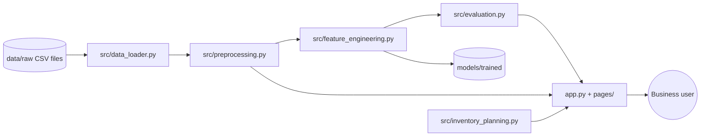

# SmartSales AI – Intelligent Sales & Demand Forecasting Platform

> Predict Sales. Understand Demand. Make Smarter Business Decisions.

SmartSales AI is a Python and Streamlit application built on the Kaggle
[Store Sales – Time Series Forecasting](https://www.kaggle.com/competitions/store-sales-time-series-forecasting)
dataset (54 stores, 33 product families, 2013–2017).

## Status

| Area                                                            | Status                                   |
| --------------------------------------------------------------- | ---------------------------------------- |
| Dataset loading, validation and summaries                       | Done                                     |
| Data cleaning and merging (oil, holidays, stores, transactions) | Done                                     |
| Feature engineering (date, lag, rolling, growth)                | Done                                     |
| Evaluation metrics (MAE, MSE, RMSE, MAPE, RMSLE, R², WAPE)     | Done                                     |
| Exploratory analysis of auxiliary data                          | Done                                     |
| Data Explorer page                                              | Done                                     |
| Inventory planning page                                         | Done                                     |
| Dashboard                                                       | Done (sales KPIs wait for `train.csv`) |
| Sales EDA, baseline and ML models, LSTM/GRU, forecasting page   | **Pending `train.csv`**          |
| Model management, reports and exports                           | Pending                                  |

**`train.csv` is not included in the current dataset folder.** It holds the
historical sales that every forecasting model learns from. The pages that need it
show a clear message until the file is added.

## Project architecture



Machine-learning code lives in `src/` and never imports Streamlit. The web layer (`app.py`,
`ui.py`, `pages/`) only calls `src/`.

## Folder structure

```
SmartSales-AI/
  app.py                  Dashboard (entry point)
  ui.py                   Shared Streamlit helpers and cached data access
  config.py               Paths, horizons, lag/rolling windows, thresholds
  pages/
    2_Data_Explorer.py
    3_Exploratory_Analysis.py
    8_Inventory_Planning.py
  src/
    data_loader.py        Locate, load, validate and summarise CSV files
    preprocessing.py      Cleaning, leakage-safe oil fill, holiday flags, merges
    feature_engineering.py Date, lag, rolling and growth features
    evaluation.py         Metrics and chronological splits
    inventory_planning.py Reorder point, order quantity, shortage, overstock
  tests/                  pytest suite (50 tests)
  assets/styles.css       Custom theme
  data/raw/               Kaggle CSV files (not committed to GitHub)
  data/processed/         Generated datasets
  models/trained/         Saved models (not committed)
  reports/                Figures and exports
```

## Installation

Requires Python 3.10 (the project is developed and checked on 3.13; no 3.10-only syntax is used).

```bash
python -m venv .venv
source .venv/bin/activate          # Windows: .venv\Scripts\activate
pip install -r requirements.txt
```

## Dataset setup

Place the Kaggle files in `data/raw/` using these exact names:

`train.csv`, `test.csv`, `stores.csv`, `oil.csv`, `holidays_events.csv`,
`transactions.csv`, `sample_submission.csv`

Or keep them anywhere on your machine and set the folder:

```bash
# macOS / Linux
export SMARTSALES_DATA_DIR=/path/to/store-sales
# Windows (PowerShell)
$env:SMARTSALES_DATA_DIR="C:\path\to\store-sales"
```

The sidebar in the app also accepts a folder path. Original files are never modified: the app
reads them and writes only copies (CSV downloads and generated files).

## Running the application

```bash
streamlit run app.py
```

## Running the tests

```bash
python -m pytest -q
```

Data tests run against the real files and are skipped when a file is absent. Logic tests use
small hand-written inputs that check arithmetic and the no-leakage rule.

## Methodology and data-leakage rules

* **Chronological validation only.** Random splits are never used for time-series data.
  `chronological_split` and `rolling_origin_folds` keep every training date before every validation date.
* **Lag and rolling features** are computed per store-family series. Rolling statistics are shifted one
  day, so a row never sees its own sales.
* **Oil prices** are forward-filled only. The first rows, which have no earlier price, are back-filled from
  the first known price and reported separately.
* **Transactions** end on 2017-08-15, before the test window (2017-08-16 to 2017-08-31). They are shown
  for analysis and are not used as future features.
* **Zero and negative sales** are counted and reported, not removed. Zeros can be real (product not
  stocked, store closed), and negatives can be returns.
* **Holidays:** national holidays are flagged from `Holiday` (not transferred), `Transfer` and `Bridge`
  rows. `Event` rows (for example World Cup matches, Black Friday) are flagged separately.
  Local and regional holidays are kept in the data but not yet used as features.
* **Metrics:** MAPE skips zero actuals and reports how many were skipped. WAPE is the stable alternative.
  RMSLE matches the Kaggle competition metric; predictions are clipped at zero before the log.

## Inventory planning

Stock levels are not in the Kaggle dataset, so the Inventory Planning page takes your own figures.

* Expected lead-time demand = average daily demand x lead time
* Reorder point = expected lead-time demand + safety stock
* Target stock level = average daily demand x planning horizon + safety stock
* Recommended order = max(0, max(target level, minimum stock) − current stock)
* Estimated shortage = max(0, expected lead-time demand − current stock)
* Days of cover = current stock ÷ average daily demand (stock with no demand is flagged as overstock)

These are planning estimates based on the demand you enter, not guaranteed outcomes.

## Deployment (Streamlit Community Cloud)

1. Push the project to GitHub. `.gitignore` keeps the raw CSVs and trained models out of the repository.
2. In Streamlit Community Cloud, create an app from the repository with `app.py` as the main file.
3. Upload the dataset through the app's sidebar folder setting or mount it as a secret path. Do not hard-code
   local paths. Set `SMARTSALES_DATA_DIR` in the app's secrets if the files are kept elsewhere.

## Limitations

* The app cannot produce sales forecasts until `train.csv` is provided.
* Inventory figures depend on user input. The dataset contains no stock data.
* Oil prices in the test window come from the provided file. In real forecasting, future oil prices are unknown,
  so the oil feature would need a forecast or be dropped.
* Holiday flags are national only.

## Future enhancements

Sales EDA and the forecasting page, baseline and ten ML models, ARIMA/SARIMA/SARIMAX/ETS, LSTM and GRU
experiments, model management and versioning, PDF/Excel/CSV reports, and demand classification.

## Conclusion

The data layer, leakage-safe preprocessing, feature engineering, metrics, inventory planning and the first
three pages are built and tested. The forecasting core is ready to be connected once `train.csv` is added.
